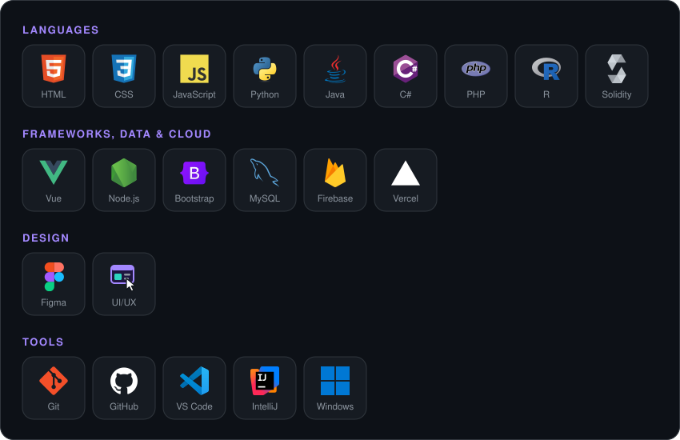
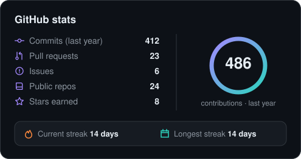
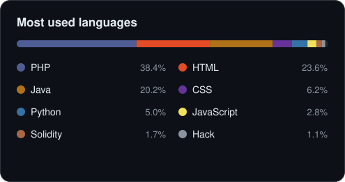

  

  &nbsp;
  

## 👋 About me

I'm **Claudio Luiz Defrein Ionck**, a Software Engineer from Joinville, SC — Brasil, graduated in Software Engineering at **UNIVILLE**.
I like turning real-world problems into simple tools people actually use.

- 🛠️ Building **web apps, management dashboards and interactive 3D websites**
- 🎨 Care about **UI/UX** — clean, intuitive interfaces designed in Figma
- 📈 Always leveling up — currently deeper into **Vue**, **Node.js** and **C#**
- 🤝 Open to collaborating on web projects and small-business tools
- ⚡ Fun fact: I automate anything I have to do more than twice

## 🧰 Tech stack

  

## 🚀 Featured projects

<table>
  <tr>
    <td width="50%" valign="top">
      <h3><a href="https://github.com/ClaudioIonck/mesa-de-analise">🎞️ Mesa de Análise</a></h3>
      Frame-by-frame video analysis tool that runs right in the browser — no install needed.
        
      <code>Web app</code> <code>GitHub Pages</code>
    </td>
    <td width="50%" valign="top">
      <h3><a href="https://github.com/ClaudioIonck/panificadora-back-defrein">🥖 Panificadora BACK &amp; DEFREIN</a></h3>
      Online ordering site for a family bakery: weekly order cycle, admin panel and delivery route.
        
      <code>Web app</code> <code>WhatsApp orders</code>
    </td>
  </tr>
</table>

## 📊 GitHub stats

  
  

  

  

<!-- Cards updated automatically by .github/workflows/profile.yml — no third-party card services. -->
